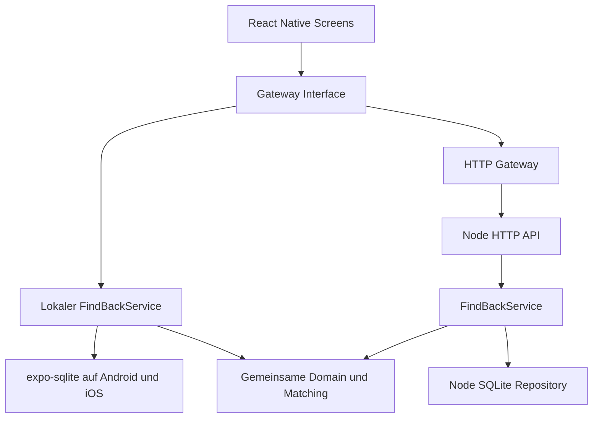

# Architektur und Erweiterung

## Aufbau

`@findback/core` enthält keine React-, Netzwerk- oder SQLite-Abhängigkeiten. `applyAction` validiert einen Befehl, prüft Zustandsübergänge und liefert einen neuen Zustand. `FindBackService` serialisiert Schreibvorgänge und persistiert den vollständigen Übergang, bevor die UI Erfolg meldet. Fehler werden an die UI zurückgegeben; es gibt keinen stillen Wechsel vom Servermodus in einen separaten lokalen Zustand.

## SQLite im Prototyp

Beide nativen Plattformen nutzen `expo-sqlite`; der Server nutzt `node:sqlite`. Der Browser hat einen ausdrücklich separaten localStorage-Adapter. Die SQLite-Tabelle `app_state` enthält einen versionierten JSON-Snapshot. Ein parametrisierter einzelner UPSERT hält Bericht, Match, Chat und Übergabe atomar zusammen. WAL ist aktiviert. Schema-/Payload-Version: 1.

Diese Entscheidung hält einen kleinen Prototyp übersichtlich und ermöglicht denselben Repository-Vertrag auf Gerät und Server. **Es ist keine normalisierte oder skalierbare Produktionsdatenbank.** Suche und Matching laufen im Speicher; Matching ist im schlechtesten Fall quadratisch. Größere Installationen benötigen normalisierte Tabellen, Indizes, inkrementelles Matching, Pagination, Migrationen und separate Bildspeicherung. Die API ist für genau einen Prozess vorgesehen.

Fotos werden auf maximal 1000 Pixel Breite verkleinert, als JPEG neu encodiert und ohne angeforderte EXIF-Daten verarbeitet. Höchstens 2.000.000 Zeichen als Data-URI pro Bild. Das vermeidet vergängliche Dateipfade und macht Fotos auch im Servermodus zwischen Geräten nutzbar. Für größere Datenmengen einen Object-Storage-Adapter ergänzen.

## Zustandsmodell

- Meldung: `open → matched → returned`.
- Vorschlag: `suggested → accepted → returned` oder `suggested → rejected`.
- Annahme reserviert beide Meldungen und verwirft konkurrierende Vorschläge.
- Ein abgelehnter Vorschlag wird nicht beim nächsten Matching wieder angeboten.
- Chat ist erst nach Annahme verfügbar. Abgeschlossene Chats bleiben lesbar.
- Ein Übergabevorschlag bestätigt den Termin für die vorschlagende Person. Die andere Person muss ebenfalls bestätigen.
- Änderung eines Termins setzt Terminbestätigungen zurück. Nach der ersten Rückgabebestätigung kann der Termin nicht mehr geändert werden.
- Erst beide Rückgabebestätigungen schließen den Fall ab. Wiederholte Bestätigung derselben Person zählt nicht doppelt.
- Löschen einer Meldung entfernt verknüpfte Chats/Treffer/Übergaben. Eine dadurch frei werdende Gegenmeldung wird wieder geöffnet.

## Matching

Gleiche Kategorie, verschiedene Meldearten und verschiedene Eigentümer sind Voraussetzungen. Fund maximal sechs Stunden vor dem angegebenen Verlust (Toleranz für ungenaue Erinnerung), maximal 30 Tage danach. Mindestens ein relevanter gemeinsamer Begriff und mindestens 15 % Textüberdeckung sind nötig.

Gewichte: Kategorie 25 Punkte, Textüberdeckung bis 40, ähnlicher Ort 20, innerhalb 24 Stunden 15 bzw. einer Woche 8. Vorschlag ab 55 Punkten. Der Score ist ein heuristischer Ähnlichkeitswert, keine statistische Wahrscheinlichkeit. Diese Startgewichte sind nicht mit realen Daten kalibriert. Positive und negative Regressionstests liegen unter `tests/core.test.ts`. Manuelle Suche bleibt unabhängig vom Matching verfügbar.

## API

| Methode | Pfad          | Zweck                                 |
| ------- | ------------- | ------------------------------------- |
| GET     | `/health`     | Verfügbarkeit, keine fachlichen Daten |
| GET     | `/v1/state`   | Zustand für das aktive Demo-Profil    |
| POST    | `/v1/actions` | Validierter Domänenbefehl             |

Außer `/health` erforderlich: `Authorization: Bearer <demo-token>` und `X-Demo-Actor: alex|mara`. Bodies sind auf 2,2 MB begrenzt. Fehler: 400 bei Validierung, 401 bei fehlendem Token, 404 bei unbekanntem Pfad, 413 bei zu großen Anfragen, 500 bei internen Fehlern ohne interne Fehlermeldungen.

Alle Meldungen sind im Demo-Bestand sichtbar. Matches werden auf Beteiligte begrenzt, Nachrichten und Übergaben zusätzlich auf akzeptierte/abgeschlossene Matches. Vor der Kontaktfreigabe zeigt die Oberfläche keine Gegenprofilnamen. Die generischen Demo-IDs sind keine privaten Kontaktdaten. **Die frei wählbare Demo-Identität ist keine Autorisierung für reale Benutzer.**

## Nächste Erweiterungen

1. Authentifizierungsadapter mit Campus-OIDC; Actor ausschließlich serverseitig aus Sitzung/Token ableiten.
2. Normalisierte Repositories, paginierte DTOs, separate Medienablage und Löschfristen.
3. Ereignisse für neue Treffer/Chats; WebSockets oder Push-Anbieter hinter einem Notification-Port.
4. Matching-Strategie durch einen austauschbaren Matcher ergänzen, Qualität an einem beschrifteten Testdatensatz messen.
5. Rollen für Fundbüro und Moderation, Missbrauchsmeldung, Kontakt-/Eigentumsprüfung und betriebliche Abläufe.
6. Bestehenden Prototyp-Stack über Expo-Upgrades schrittweise aktualisieren und auf echten Geräten regressionsprüfen.

Der Speichervertrag und der API-Gateway lassen diese Erweiterungen zu, ohne die Screens mit Datenbanklogik zu vermischen.
